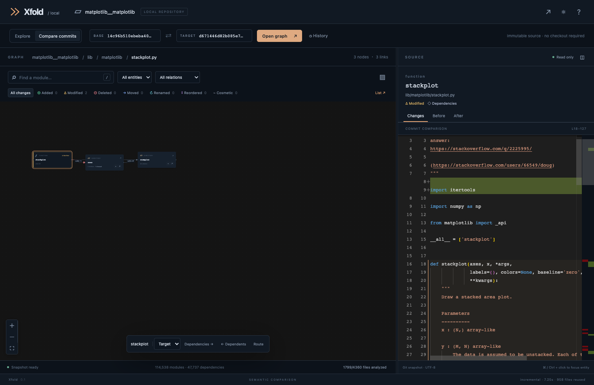

# Validation results

Measured on 2026-09-30, macOS arm64, Apple M3 Pro, 18 GiB RAM,
Node v26.8.1, Chrome 154.0.8037.58. These are local measurements,
not latency or memory guarantees. The build suite ran alongside development
checks, and timings include contention. Browser measurements describe one run.

## Correctness and recovery

- 12 Rust integration tests passed. Coverage includes cold/incremental equality,
  A→B→A, skipped commits, branches, persisted restart, symbol/import/config
  invalidation, overload reordering, ambiguous/reused sem identities, duplicate
  bodies, moves, cosmetics, CRLF/Unicode, cycles, aggregate expansion, side-specific
  paths, bare repositories, corrupt cache repair and missing Git objects.
- 3 browser/API workflows passed: hierarchy, keyboard selection/drill-down,
  source-to-node clicks, deleted source, diff expansion, search/deep links,
  reduced motion, themes, aggregate anchors, origin/path rejection, SSE,
  cancellation of active work, worker recovery and preserved completed snapshots.
- 2 launcher tests passed. TypeScript checks, Rust formatting, and Clippy with
  warnings denied passed for Xfold (`--no-deps`; the pinned vendor is unchanged).
- Packed macOS arm64 installation passed using a fresh npm prefix/cache and
  `--offline`. The installed launcher built a private Git fixture with an empty
  `PATH`, so neither Rust, sem nor a Git executable was available to it.
  Reopening the same snapshot parsed/resolved zero files.
- Browser asset requests were restricted to loopback; zero external requests
  and zero page errors were observed in the real Matplotlib UI run.

## Matplotlib oracle

**51/51 passed:** 3 real pairs, 14 first-parent transitions,
and 34 explicitly synthetic SWE-Bench commits made from each base plus its code
and test patches. No Matplotlib code or tests were executed.

The oracle compared canonical hashes, complete normalized nodes, and complete
semantic edges against an independent forced cold build for each target.
The final native build also passed all three real pairs; its graph hashes equal the extended-run hashes.

| Measurement | Observed result |
| --- | --- |
| Nodes per snapshot, including navigation containers | 106,611–124,570 |
| Incremental wall time, median / range | 9.32 s / 6.03–15.06 s |
| Cold wall time, median / range | 19.83 s / 13.11–60.30 s |
| Median per-pair cold/incremental ratio | 2.18× |
| Files reused per target build | 122–962 |
| Maximum sampled worker RSS | 2.80 GiB |
| Extended-suite elapsed time | 36.3 min |

RSS is the maximum sampled individual parser-worker resident memory, not total
application memory. `artifactBytes` measures serialized normalized graph size,
not deduplicated disk occupancy. `filesParsed`, green-file reuse, and edge reuse
counters come from sem; edge counters precede Xfold's normalization/deduplication.
Receipt duration excludes final manifest/index publication; wall times include
worker output and oracle object loading. Raw per-case metrics are retained in
[the full report](validation/matplotlib-benchmark.json).

## Real browser measurements

The stackplot comparison contained 114,538 graph nodes and
47,737 semantic dependencies. Rendering remained bounded
while the backend retained full topology. First graph access includes construction
of an immutable hierarchy index; subsequent scopes reuse it. A warm projection
uses the completed-view cache. Build/comparison timing can be zero on a cache hit.

| Operation | Observed time |
| --- | --- |
| `initialBuildAndComparisonMs` | 0 ms |
| `comparisonLoadMs` | 315 ms |
| `searchMs` | 977 ms |
| `fileGraphViewMs` | 1,187 ms |
| `sourceDiffMs` | 4 ms |
| `browserOverviewReadyMs` | 1,035 ms |
| `selectionToSourceMs` | 227 ms |
| `nextScopeGraphViewMs` | 134 ms |
| `warmGraphViewMs` | 2 ms |
| `warmSourceDiffMs` | 2 ms |

[Browser report](validation/matplotlib-browser.json) ·
[Package smoke report](validation/package-smoke.json) ·
[Final-build oracle](validation/matplotlib-final-smoke.json)

## Release status

The local npm tarball and native package are **macOS arm64**. Clean cross-platform
machines and CI were not available in this session. Workflows define macOS x64,
Linux glibc arm64/x64, and Windows x64 builds and native-host package smoke tests;
those platforms require successful CI before being called validated releases.
Nothing has been published to npm.

The launcher's Node.js 22 minimum is configured and CI uses Node 22; the local
runtime check used the Node version shown above. sem remains a static analyzer
with conservative resolution and no call-site spans. Very large repositories
can require substantial memory and first-build time; the report establishes
behavior for these fixtures, not an upper bound for arbitrary repositories.

## Light branch validation

The light review workflow passes 14 Rust integration tests, two launcher tests,
and five Chrome/Playwright tests. Coverage includes changed-module containment,
unrelated sibling exclusion, deleted source, direct children, node budgets,
first-parent defaults, root commits, empty comparisons, result pagination,
source links outside the projected graph, and equal-height review panes.
TypeScript checking, the production web build, and the debug native build pass.
The inherited Monaco bundle still produces Vite's large-chunk warning.

The `stackplot` pair in `fixtures/matplotlib.json` was also checked against the
local bare Matplotlib repository: the target snapshot contains **114,538
modules**, while the light overview renders **11 nodes**, **one dependency**,
and lists **three semantic changes**, without truncation. This measures the
projection size; full snapshot analysis remains unchanged. The local report is
`artifacts/light-matplotlib-smoke.json`.
